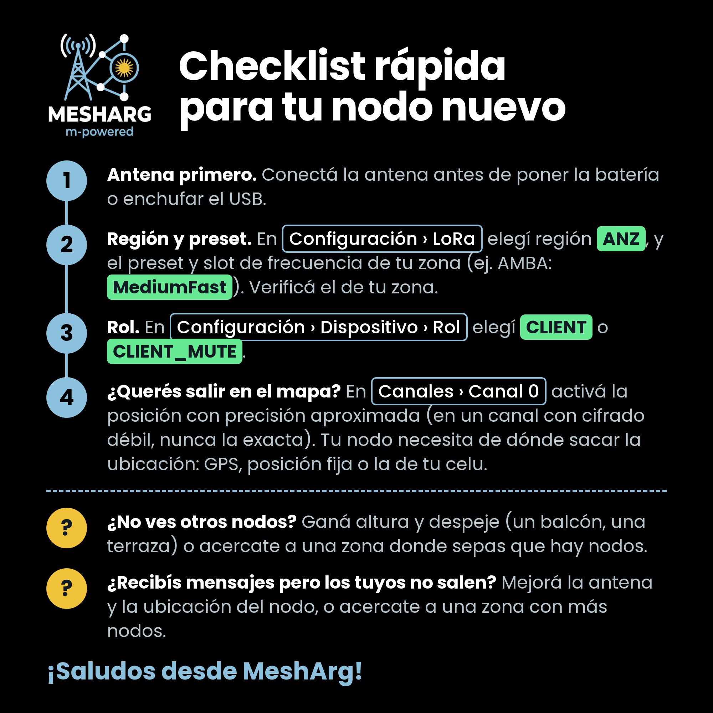

# Comunidad Meshtastic Argentina

**Somos una comunidad técnica y social que construye soberanía tecnológica en el espectro radioeléctrico - mesharg.com.ar - Meshtastic - Meshcore - Reticulum**

---
## Índice

- [1. ¿Qué es Meshtastic y qué necesito para arrancar?](#1-qué-es-meshtastic-y-qué-necesito-para-arrancar)
- [2. ¿Es legal? ¿Necesito licencia?](#2-es-legal-necesito-licencia)
- [3. ¿Qué placa compro?](#3-qué-placa-compro)
- [4. ¿Hay algo que nunca tengo que hacer?](#4-hay-algo-que-nunca-tengo-que-hacer)
- [5. ¿Cómo la configuro en Argentina?](#5-cómo-la-configuro-en-argentina)
- [6. ¿Qué rol le pongo a mi nodo?](#6-qué-rol-le-pongo-a-mi-nodo)
- [7. ¿Hasta dónde llega y cómo mejoro la cobertura?](#7-hasta-dónde-llega-y-cómo-mejoro-la-cobertura)
- [8. ¿Por qué nadie retransmite mis mensajes?](#8-por-qué-nadie-retransmite-mis-mensajes)
- [9. ¿Es privado? ¿Quién puede leer mis mensajes?](#9-es-privado-quién-puede-leer-mis-mensajes)
- [10. ¿Y MQTT? ¿Necesito internet?](#10-y-mqtt-necesito-internet)
- [11. Ya tengo mi nodo, ¿Y ahora?](#11-ya-tengo-mi-nodo-y-ahora)
- [Recursos adicionales](#recursos-adicionales)
---
### 1.  ¿QUÉ ES MESHTASTIC Y QUÉ NECESITO PARA ARRANCAR?

Es un proyecto de código abierto para armar redes en malla con radios LoRa. Mandás mensajes de texto, posición y telemetría de nodo en nodo, sin internet, sin celular y sin antenas de telefonía. Cada nodo puede retransmitir los mensajes de otros, así que cada uno que se suma agranda la red.

Para arrancar necesitás:
- Una placa compatible, en versión 915 MHz.
- Una antena para esa banda.
- Batería o fuente de alimentación.
- La app oficial de Meshtastic (Android o iOS), que se conecta a la placa por Bluetooth.

Meshtastic usa LoRa, no LoRaWAN: no hay gateway ni servidor central. La red se sostiene con los nodos de la comunidad.

### 2. ¿ES LEGAL? ¿NECESITO LICENCIA?

No necesitás licencia. Meshtastic transmite en la banda de 915 MHz (902-928 MHz), de uso compartido para equipos de baja potencia, sin licencia individual. Eso sí: respetá los límites de potencia y no le agregues amplificadores.

Si sos radioaficionado y activás el modo "con licencia" en la app, se desactiva el cifrado: no vas a poder usar canales cifrados ni mensajes directos cifrados.

### 3. ¿QUÉ PLACA COMPRO?

Depende de dónde la vas a usar.

Para llevar encima o con panel solar -> placas nRF52.
Consumo muy bajo: rinden con una batería 18650 o un panel chico.
- Heltec T114
- RAK WisBlock (RAK4631)
- Kit XIAO nRF52840 + Wio-SX1262
  (la XIAO sola no trae radio LoRa: comprá el kit)

Para un nodo fijo y enchufado -> placas ESP32.
Baratas y populares, pero consumen más.
- Heltec V3 / V4 (con pantalla OLED)
- LilyGO T-Beam (trae GPS)

Dónde comprar: AliExpress, o en el país Starware y MercadoLibre.
Siempre la versión de 915 MHz. Ni 868 ni 433.

Baterías: para nodos móviles, LiPo o 18650. Para nodos solares fijos, LiFePO4, dimensionada para aguantar 2 o 3 días sin sol.

### 4. ¿HAY ALGO QUE NUNCA TENGO QUE HACER?

Sí, la regla de oro: NUNCA enciendas la placa sin la antena conectada.

Transmitir sin antena puede dañar la etapa de radio para siempre. Primero la antena, después la batería o el USB. Vale también cuando la enchufás a la compu para flashearla.

### 5. ¿CÓMO LA CONFIGURO EN ARGENTINA?

- Firmware: instalalo desde flasher.meshtastic.org. Elegí la última versión Beta (las Alpha son experimentales).
- Región: ANZ, en todo el país.
- Preset: el de tu zona. Cada comunidad elige el suyo según el tamaño de su malla. En el AMBA usamos MediumFast.
- Zona horaria: ART3 (UTC-3).

¿Por qué importa tanto el preset? Con el canal por defecto, el preset define también la frecuencia en la que transmitís. Dos nodos con presets distintos no se escuchan aunque estén uno al lado del otro.

¿No sabés qué preset usar? Preguntá en el hilo de tu provincia, en el grupo de Telegram de MeshArg.

### 6. ¿QUÉ ROL LE PONGO A MI NODO?

Ante la duda: CLIENT.

- CLIENT (por defecto): el nodo de uso diario. Lo usás con la app y retransmite mensajes de otros.
- CLIENT_MUTE: no retransmite. Ideal para un segundo nodo en la misma casa o en zonas con muchos nodos cerca.
- CLIENT_BASE: para el nodo del techo de tu casa. Retransmite siempre lo que va o viene de tus nodos favoritos y el resto lo maneja como CLIENT.
- ROUTER: NO en ciudad ni en edificios. Es para sitios altos y estratégicos (cerros, torres), coordinado con la comunidad. Mal ubicado, congestiona la malla.
- ROUTER_LATE: retransmite después que los demás. Sirve para tapar huecos de cobertura sin pisar al resto.
- TRACKER / SENSOR: para enviar posición o datos de sensores con bajo consumo.

### 7. ¿HASTA DÓNDE LLEGA Y CÓMO MEJORO LA COBERTURA?

Valores orientativos por salto (dependen del preset, la antena y la altura):
- 0,5 a 2 km: ciudad densa, con edificios.
- 3 a 10 km: periurbano o con vista parcial.
- 50 km o más: con línea de vista y altura.

Para mejorar:
- Altura: subí la antena lo más que puedas (techo, terraza, mástil). La altura le gana a la potencia.
- Línea de vista: cuantos menos obstáculos entre nodos, mejor.
- Antena: sintonizada para 915 MHz. Para enlaces punto a punto, una Yagi.
- Cable: coaxial corto y de baja pérdida (LMR240 o LMR400).
- Rol: el adecuado para tu ubicación (ver punto 6).

### 8. ¿POR QUÉ NADIE RETRANSMITE MIS MENSAJES?

Revisá esto, en este orden:
1) ¿Estás en región ANZ?
2) ¿Usás el mismo preset que tu comunidad local? Con otro preset transmitís en otra frecuencia y nadie te escucha.
3) ¿Hay algún nodo a tu alcance?
4) ¿Tu rol retransmite? CLIENT_MUTE, por ejemplo, no lo hace.
5) ¿El hop limit no es muy bajo? El valor por defecto es 3.

Y al revés: no subas el hop limit para "llegar más lejos". Cada salto extra suma tráfico para toda la malla.

### 9. ¿ES PRIVADO? ¿QUIÉN PUEDE LEER MIS MENSAJES?

- Canal por defecto: usa una clave que conoce todo el mundo. Tratalo como público: cualquiera con un nodo lo lee.
- Mensajes directos: desde el firmware 2.5 van cifrados con la clave del destinatario, así que solo él los lee. Y sí tienen ruteo: desde la 2.6 aprenden el camino después del primer envío.
- Canales privados: tienen clave propia y se comparten por QR desde la app.
- Posición: lo que publicás en el canal por defecto es público. Si no querés mostrar dónde vivís, bajá la precisión de posición o no la compartas.
- Aunque el contenido vaya cifrado, quién envía y a quién se ve igual.

### 10. ¿Y MQTT? ¿NECESITO INTERNET?

No necesitás internet para nada. MQTT es un puente que conecta nodos a través de internet.

En MeshArg priorizamos la malla por radio: no lo usamos en nuestras redes, aunque cada quien configura su nodo como quiera.

Una red que no depende de internet sigue funcionando cuando internet se cae.

Tené en cuenta: aunque vos no uses MQTT, un nodo cercano que sí lo use puede subir a internet lo que escucha en el canal por defecto. Otra razón para tratarlo como público.

### 11. YA TENGO MI NODO, ¿Y AHORA?

Seguí este checklist rápido para empezar:

---

# RECURSOS ADICIONALES

- [Problemas Frecuentes](./Recursos/problemas_frecuentes.md)
- [FAQ Visual](./FAQ_visual/README.md)

---

# ¡SUMATE A LA MALLA!

Dudas, presets y novedades de cada zona en el grupo de Telegram de MeshArg. Hay un hilo para cada provincia:
https://t.me/meshtastic_argentina

### Mapa de nodos del AMBA: https://mapa-mesh.hopto.org y https://meshseer.nemexix.com

Se arman 100% por radio, con un nodo que solo escucha. Para aparecer: compartí tu posición, usá MediumFast y que tu nodo llegue por radio, directo o a través de otros nodos.

---

Basado en parte en "La Biblia de Meshtastic" (BRC Mesh E-Zine #1, Daniel Jerez LU1VJK / BarilocheMesh), licencia CC BY-NC-SA 4.0. Este FAQ se comparte bajo la misma licencia.
Comunidad MeshArg

